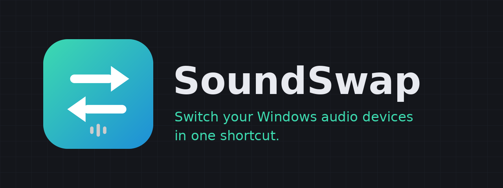

<p align="center"></p>

<p align="center">
  <a href="https://github.com/Stevehunn/soundswap/releases/latest"></a>
  <a href="https://github.com/Stevehunn/soundswap/actions/workflows/build.yml"></a>
  <a href="LICENSE"></a>
  
</p>

[English](README.md) · [Français](README.fr.md) · **Español**

# SoundSwap

**Cambia de micrófono y auriculares (o altavoces) en Windows con un solo atajo de teclado.**
SoundSwap vive en el área de notificación y cambia al instante los dispositivos de audio predeterminados de **salida** y de **entrada**.
Gratis, de código abierto ([MIT](LICENSE)), de la familia [SoundDeck](https://sounddeck.stream/soundswap).

## Características
- **Configuraciones**: un nombre + un dispositivo de salida + uno de entrada (+ un atajo opcional), en tarjetas que puedes **arrastrar para reordenar**.
- **Atajos globales**: un atajo para «siguiente configuración» y uno por configuración, que funcionan aunque la ventana esté minimizada u oculta.
- **Área de notificación**: clic izquierdo abre la ventana, clic derecho cambia de configuración. Al cerrar la ventana se pregunta: minimizar, salir o cancelar.
- **Temas**: oscuro, claro, del sistema, o **personalizado** (4 colores a tu gusto, vista previa en vivo, preajustes).
- **10 idiomas**: English, Français, Español, Deutsch, Português, Italiano, Русский, 中文, 日本語, العربية.
- **Actualizaciones integradas**: un botón *Nueva versión disponible* descarga por ti la última release de GitHub (verificada); solo queda instalarla.
- **Inicio con Windows** (minimizado), instancia única, notificación opcional en cada cambio.

## Instalación
1. Descarga **`SoundSwap-Setup-<versión>.exe`** desde la [última release](https://github.com/Stevehunn/soundswap/releases/latest) y ejecútalo.
   Se instala solo para el usuario actual: no hacen falta permisos de administrador.
2. ¿Sin instalador? Descarga el `…-portable.zip`, descomprímelo donde quieras y ejecuta `SoundSwap.exe`.

Requisitos: Windows 10 u 11 (64 bits); .NET incluido.
Windows SmartScreen puede mostrar un aviso porque el instalador aún no está firmado: *Más información → Ejecutar de todas formas*.

## Guía de uso
1. **Crear una configuración**: *+ Nueva configuración* → nombre, salida, entrada, atajo opcional → *Confirmar*.
2. **Aplicarla**: botón **▶** de la tarjeta, su atajo, o el menú del icono de notificación.
3. **Recorrerlas**: el atajo de arriba (por defecto `Ctrl + Alt + →`) pasa a la siguiente configuración. El orden es el de las tarjetas (arrastra para cambiarlo).
   Se omiten las configuraciones cuyos dispositivos estén desconectados.
4. **Grabar un atajo**: haz clic en el campo y pulsa las teclas (al menos una de Ctrl / Alt / Mayús / Win). `Esc`, `Retroceso`, `Supr` o **✕** lo borra.
   Un mensaje rojo indica que otro programa ya usa esa combinación.
5. **Dejarlo en marcha**: cierra con **X** → *Minimizar al área de notificación*. Los atajos solo funcionan mientras SoundSwap esté en ejecución.
6. **Iniciar con Windows**: marca la casilla de abajo. SoundSwap arranca oculto en el área de notificación al iniciar sesión.
   (Si lo desactivas en la pestaña *Inicio* del Administrador de tareas, SoundSwap lo respeta.)
7. **Personalizar**: elige tema e idioma arriba. Con *Personalizado*, **Personalizar…** abre la elección de colores.

Más detalles: [guía de usuario completa](docs/articles/user-guide.md) (en inglés).

## Actualizaciones y privacidad
SoundSwap consulta la última release de este repositorio unos 10 segundos después de arrancar y cada 12 horas. Si hay una versión más reciente aparece un botón:
haz clic para descargar el instalador (solo desde `github.com`; se verifican tamaño y SHA-256) y otra vez para instalarlo.
Esa comprobación es la **única** petición de red de SoundSwap: sin telemetría ni cuenta. Desmarca *Buscar actualizaciones automáticamente* para desactivarla.
Detalles: [Updates](docs/articles/updates.md).

## Solución de problemas
| Problema | Qué hacer |
|---|---|
| Un atajo muestra un mensaje rojo «no disponible» | Otro programa ya lo usa: elige otra combinación |
| Los atajos no hacen nada | Se salió de SoundSwap (no se minimizó): vuelve a abrirlo y mira el área de notificación |
| «Dispositivo no disponible» | Un dispositivo de la configuración está desconectado o desactivado en Windows |
| No arranca con Windows | Activa la opción en SoundSwap; comprueba que la pestaña *Inicio* del Administrador de tareas no esté en Deshabilitado |
| Listas con texto extraño / sin botón de actualización | Se ejecuta una versión antigua: reinstala, o `dotnet clean` y recompila; el pie de la ventana muestra la versión (`v1.2.0`) |

La configuración se guarda en `%APPDATA%\SoundSwap\data.json`; los errores se registran en `%APPDATA%\SoundSwap\error.log` (adjúntalo al informar de un error).

## Compilar desde el código
Windows 10/11 + [SDK de .NET 8](https://dotnet.microsoft.com/download/dotnet/8.0):
```powershell
git clone https://github.com/Stevehunn/soundswap.git
cd soundswap
dotnet build SoundSwap.sln -c Release
dotnet test tests/SoundSwap.Core.Tests
dotnet run --project src/SoundSwap.App -c Release
.\scripts\publish.ps1 -Version 1.2.0 -Installer -Portable   # el instalador requiere Inno Setup 6
```

## Estructura del proyecto
| Proyecto | Función |
|---|---|
| `src/SoundSwap.Core` | Lógica: configuraciones, atajos, paleta de tema, actualizador. Sin interfaz, con pruebas |
| `src/SoundSwap.Audio` | Dispositivos de audio de Windows (NAudio + `IPolicyConfig`) |
| `src/SoundSwap.App` | Aplicación WPF (MVVM): ventanas, área de notificación, atajos, temas, traducciones |
| `tests/SoundSwap.Core.Tests` | Pruebas xUnit |
| `installer/`, `scripts/`, `.github/workflows/` | Instalador, scripts de compilación, CI/publicación |

## Documentación
Todos los tipos y miembros públicos están documentados con comentarios XML; la referencia de la API y los artículos se generan con
[DocFX](https://dotnet.github.io/docfx/) desde [`docs/`](docs/) (GitHub Pages). Empieza por [Architecture](docs/articles/architecture.md).

## Contribuir
Issues y pull requests son bienvenidos: consulta [CONTRIBUTING.md](CONTRIBUTING.md) (añadir un idioma = un archivo JSON).
Seguridad: [SECURITY.md](SECURITY.md).

## Licencia
[MIT](LICENSE) © 2026 Stevehunn. Componentes de terceros: [THIRD-PARTY-NOTICES.md](THIRD-PARTY-NOTICES.md).
